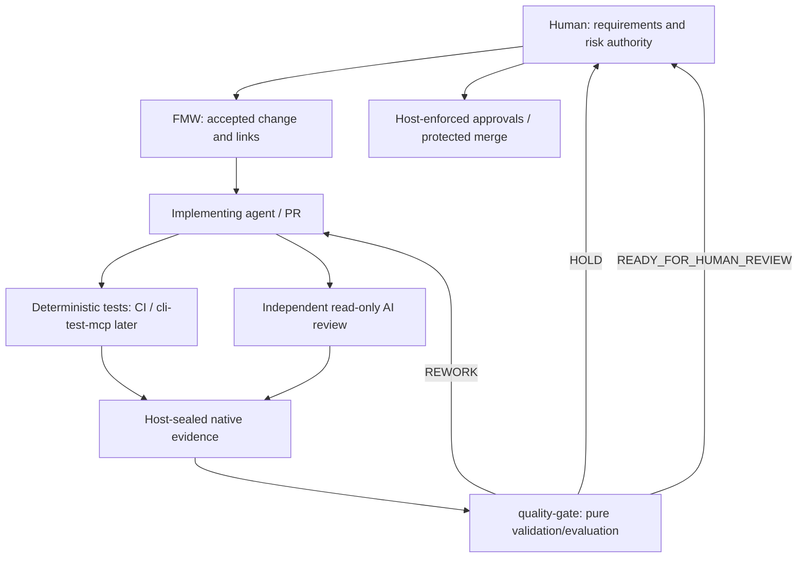

# Architecture, trust boundaries and adoption plan

## Decision

A small **deterministic quality-gate** is the common verdict interface between FMW, a test executor, and independent AI reviewers. Implement it with Python's standard library. This is deliberately not an orchestration framework, AI model gateway, CI replacement, or merge bot.

## External lessons and adoption decisions

| Source | Observed mechanism | Adopt now | Not copied |
| --- | --- | --- | --- |
| [Anthropic Code Review (2026-03)](https://claude.com/resources/articles/code-review) and [GA update (2026-10-15)](https://claude.com/ja/resources/articles/code-review-is-now-generally-available) | Parallel specialized agents; verify alleged defects, deduplicate, focus on important issues; risk-adaptive Quick/Standard/Deep | Fresh independent context, evidence-backed finding dispositions, concise human handoff | Paid Claude service, always-on parallel agents, automatic approval |
| [Cloudflare (2026-04)](https://blog.cloudflare.com/ai-code-review/) | Risk tiers based on paths/size; coordinator removes duplicates, checks severity and limits review noise; reviewer limits on cross-system effects | Deterministic changed-path risk floor, mandatory checks by tier, no unverified AI confidence as an oracle | Seven-model coordinator, vendor-specific GitLab automation, AI-driven break-glass approval |
| [OpenAI harness engineering (2026-02)](https://openai.com/index/harness-engineering/) | Agents access repeatable isolated tests, logs and browser traces; small navigable repository knowledge and feedback loops | Exact-revision observations, concise contracts, post-run evidence and repeatable evaluation | Autonomous production operation or unbounded AI loops |
| [feature-map-workflow](https://github.com/nakashima-yoshua/feature-map-workflow) | Existing REVIEW.md, risk-based code review, evidence catalog, and explicit human authority | Reuse rubrics, 3-pass review cap, external evidence links | Duplicate XML schema, tracking database or workflow state |

Numbers quoted by any vendor reflect its environment, not measured expectations for this project.

## Proposed initial architecture

- `engine.py` is a pure-ish evaluator: it reads only declared evidence files, verifies their SHA-256, and emits a result. It does not run shell commands or modify a repository.
- `cli.py` is a read-only JSON interface. Exit status `0/1/2` maps to readiness, rework and hold. It does not control external CI.
- The candidate's changed paths determine at least a minimum risk tier. Sensitive paths force HIGH; documentation-only paths can be LOW; unknown or CRITICAL risks stop. An explicitly supplied risk hint can only raise the tier.
- The policy defines required named checks by tier. There is **no fallback** from a missing mandatory check to another tier or an AI opinion. Explicit FALSE/PASS/NOT_RUN and matching `head_sha` are required for each.
- Independent AI review is separate from implementation and anchored to the same SHA. Important findings remain open until verified fixed, dismissed for a concrete reason, or escalated. The number of re-review passes is bounded by host policy.
- The report's `ready_to_merge` remains `false` for **all** states. The only positive state means ready *for human review*.

### Policy/evidence provenance and limits

Trust levels:

1. **Untrusted**: candidate code, PR text, AI reviews, model prompts and model-produced JSON. They are observations or proposals, not permissions.
2. **Trusted by configuration**: host-controlled policy file and expected policy digest, changed-files manifest from Git/CI, native CI/test outcomes, independent evidence store, and reviewer identity/session attestations. The operator must protect these *before* allowing an AI to create inputs.
3. **External authorities**: GitHub Rulesets/approvals and human release owner. `quality-gate` cannot replace them.

The CLI checks a supplied evidence file's bytes against a supplied SHA-256. **It cannot establish that the input hash was independently anchored**, that the underlying test command truly ran, that a session ID was authenticated, or that the result/plan was approved. Hashes created by the same untrusted writer can all be forged. Production usage requires a trusted adapter which constructs assessment records from actual CI/check results, seals native outputs in an OS-protected store, anchors the manifest/hash in a separate permission domain and verifies policy/revision identity. No untrusted user can change the policy, evidence store, or host workflow. The operator must also handle file-to-hash race conditions through immutable artifacts, ACLs and host-side verification.

Do not pass raw customer data or secrets to model reviewers or public CI. Cloudflare's experience with prompt-boundary injection is a reminder to keep untrusted PR text as data; no instruction in PR text may reconfigure this gate. No LLM/provider communication is implemented here.

### Current integration status

| Interface | State |
| --- | --- |
| Offline policy + assessment evaluator | Implemented and unit-tested in this repository |
| Native `cli-test-mcp` test result adapter | **Not implemented**: test MCP is currently in design stage |
| Existing FMW Feature Map / evidence links | Design contract only; no FMW source or XML changes in this PR |
| Independent Codex reviewer invocation and trustworthy session attestation | Manual pilot protocol; no automatic reviewer service |
| Protected GitHub Rulesets, human sign-off, CI enforcement | External setup and verification; never inferred from this PR |

## Test matrix (mandatory local unit tests)

- Valid LOW/MEDIUM/HIGH sample and risk escalation from sensitive path/hint.
- All required checks present, SHA-bound, passing and file hashes matching.
- Failing check -> REWORK; missing/not-run/blocked check -> HOLD.
- Stale revisions and wrong evidence hash -> HOLD; invalid/traversal/symlink paths -> fail closed.
- Missing, same-session or stale review -> HOLD; Important finding -> REWORK; 3-pass unresolved -> HOLD; unverifiable dismissal -> HOLD; trivial/pre-existing finding does not automatically block.
- Unknown material/CRITICAL risk -> HOLD; policy tampering via expected digest -> HOLD.
- Output never declares merge approval.

## Pilot & successive iterations

1. Run the gate on saved **synthetic** fixtures (this PR), then an approved local PR with trustworthy saved CI evidence. Measure false positive and missing-evidence rates.
2. Add a *trusted* result normalizer for `cli-test-mcp` once its Test Engine, MCP, and Result schema have been implemented, and test against real runs without forging individual-case PASS.
3. Add a read-only reviewer adapter, structured finding deduplication and high-risk escalation; keep FMW the system of record for requirements.
4. Only after one or more real pilots, consider specialized parallel reviewers and a PR annotation adapter. Evaluate human time, token cost, discovered material defects, stability and risks. Do not add approval or deployment authority to this tool.

## Extension points (reserved, not built)

- `TestResultAdapter`: translate *verified* per-case results and checked revision from cli-test-mcp to required named checks; never infer passed from overall process exit.
- `ReviewRecordAdapter`: combine verified read-only reviewer findings and dispositional evidence, removing duplicates by affected root cause; no voting-as-proof.
- `PRReporter`: write a compact advisory report without approving or merging. Use GitHub's separate protected review and approval process.
